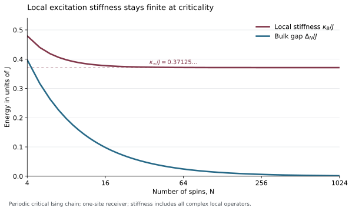

# Quantum Energy Teleportation Limits

A remote measurement can make locally inaccessible energy available to a receiver. How strongly can the extracted energy respond when the measurement reveals very little about the receiver's surroundings?

This project establishes a quadratic response bound for arbitrary local measurement instruments and arbitrary outcome-dependent quantum channels. The controlling energetic scale is **local excitation stiffness**. For a unique ground state, a nonzero bulk spectral gap is sufficient; an exactly solved critical Ising example shows that it is not necessary.

## Main result

The system starts in a pure ground state. Alice measures region $A$, records an outcome $M$, and sends it to Bob, who acts on $B$. No Hamiltonian evolution occurs between these operations. Let $C$ include $B$ and every interaction term Bob can change; Alice's region is disjoint from $C$.

Write $H_B$ for those energy terms, $h_B=\inf_c\lVert H_B-cI\rVert$ for their centered norm, and $\lambda_B$ for the smallest positive eigenvalue of Bob's ground-state marginal. The local stiffness $\kappa_B\gt 0$ lower-bounds the energy cost per variance of **every local operator**, including non-Hermitian operators. The [model](science/model.md) gives the exact definition.

The average decrease of total system energy during Bob's feedback obeys

```math
\begin{aligned}
E_{\mathrm{ext}}&\le
\frac{h_B^2}{\kappa_B\lambda_B}
\sum_m p_m
\left\lVert \rho_{C|m}-\omega_C\right\rVert_1^2\\
&\le
\frac{2h_B^2}{\kappa_B\lambda_B}\,I(M:C)\\
&\le
\frac{2h_B^2}{\kappa_B\lambda_B}\,I(A:C)_\omega .
\end{aligned}

```

Information is measured in nats. Every outcome is included with its probability. The theorem allows rank-deficient local marginals and imposes no lower bound on individual outcome probabilities or bound on the number of outcomes.

The proof retains the energy that a feedback channel would cost on the unmeasured ground state. Its useful response is bounded by the square root of that cost. Optimizing the resulting quadratic gives the bound above.

| Result | Consequence | Full account |
|---|---|---|
| Universal conditional-distance and information bounds | Arbitrary quantum channels cannot convert weak steering into first-order average energy gain | [Energy and information](science/energy_information.md) |
| Squared connected-correlation bound | A valid spatial correlation envelope can be squared when the local constants are uniform | [Correlation bounds](science/correlation_bounds.md) |
| Exact small-system families | The information power one and correlation power two are both attained | [Sharpness](science/sharpness.md) |
| Critical Ising receiver | The information coefficient stays finite while the bulk gap closes | [Local excitation stiffness](science/local_stiffness.md) |

The spatial corollary additionally depends on Alice's local support rank and smallest positive marginal eigenvalue. It does not identify an optimal distance-decay exponent. The exact families establish sharp powers of information and correlation, not sharp powers of distance.



The curves use the exact finite-ring formulas in [Local excitation stiffness](science/local_stiffness.md). The [plot generator](verification/plot_critical_stiffness.py) contains no fitted parameters.

## Read the science

Start with the [operational model and result map](science/model.md), then follow the [general proof](science/energy_information.md). The [local-stiffness calculation](science/local_stiffness.md) explains why a bulk gap can be replaced by a local energy scale. The [correlation bound](science/correlation_bounds.md) and [attaining examples](science/sharpness.md) give the corresponding physical consequences.

The [interpretation](science/interpretation.md) connects the results, the energy ledger and the assumptions. [Related work](references/RELATED_WORK.md) compares actual statements and operational models; the [bibliography](references/references.bib) supplies the primary sources.

## Learn the project

The single educational anchor is **John Watrous, *The Theory of Quantum Information* (2018)**. The [Watrous bridge](learning/ANCHOR_AND_BRIDGE.md) identifies the relevant parts of the author's available text, translates the notation and entropy conventions, and connects its channel and information tools to the energy bound developed here.

The [30-milestone map](learning/MILESTONES.md) gives a common understanding route through the project. Its **10 background/preliminaries milestones** assemble states, operations, local energy, distinguishability and information into the QET setting. Its **20 narrative/innovation milestones** follow the balance between cost and response through the information ceiling, spatial consequence, critical-chain certificate, sharpness examples and physical interpretation.

Each milestone has a central question, an understanding target, dependencies, a conceptual connection and source pointers. Use the bridge alongside the map for self-directed study. The [reading guide](llms.txt) routes scientific and learning questions to their authoritative files; the direct proof route above remains available for specialist reading.

## Reproduce the finite checks

With Python 3.12 and NumPy installed, run from the repository root:

```bash
python3 -m pip install -r verification/requirements.txt
python3 verification/run_all.py
```

The deterministic checks reconstruct finite Hamiltonians, instruments and channels, compare direct energy changes with the compressed proof observable, and verify the exact sharpness and critical-chain formulas. The [verification guide](verification/README.md) describes the commands, reference output and what each calculation establishes. Universal and asymptotic claims follow from the written arguments.

## Scope and attribution

The energy observable includes interaction terms crossing Bob's boundary. For arbitrary channels, the theorem bounds **system-energy decrease**; it does not equate that decrease with a controller's net work after heat, preparation and reset costs. The protocol is one-way and has no intervening propagation.

Uniform asymptotic bounds require controlled local stiffness, energy norms and local marginal eigenvalues. A fixed local dimension alone does not guarantee that conditioning. The coefficient is explicit but is not claimed optimal.

Model-specific linear energy-information relations and correlator-squared feedback formulas are established QET results. The contribution developed here is a general converse for the stated operation class, with support-aware constants and a local-stiffness formulation. The [prior-work comparison](references/RELATED_WORK.md) credits those earlier relations and the local-passivity framework.

## Purpose and contact

This repository serves as a record of the work and a guide for the author’s self-directed learning. For discussion or potential collaboration, please contact Ruge Lin at [gogoko699@gmail.com](mailto:gogoko699@gmail.com).
